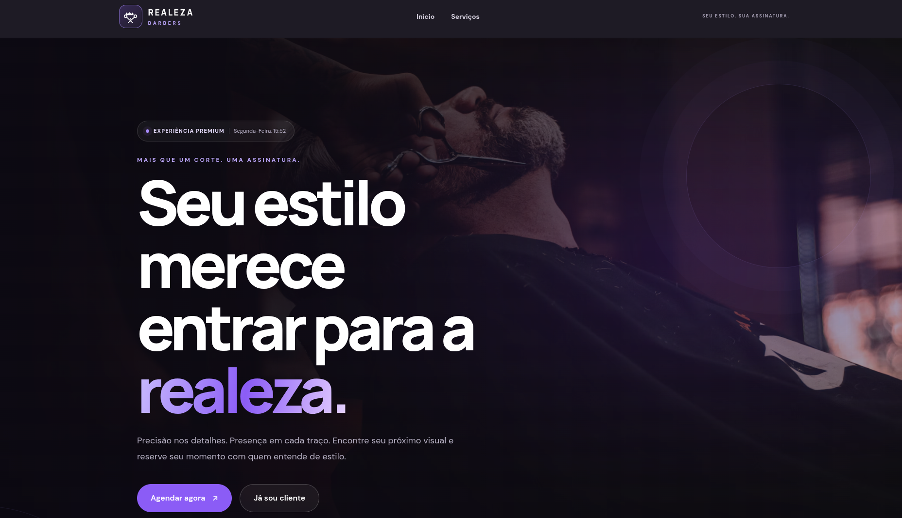
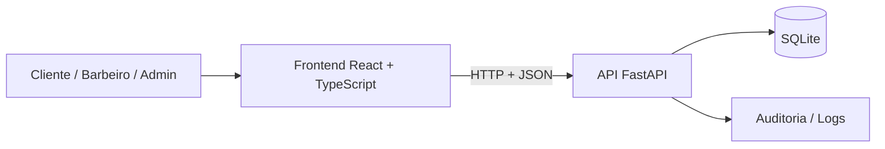

<div align="center">

# ✂️ Realeza Barbers 👑

### Gestão de agendamentos, serviços e clientes em uma experiência web moderna.

**Uma plataforma para conectar clientes e profissionais, organizar horários e simplificar a rotina de uma barbearia.**

[](https://react.dev/)
[](https://www.typescriptlang.org/)
[](https://tailwindcss.com/)
[](https://fastapi.tiangolo.com/)
[](https://www.python.org/)
[](https://www.sqlite.org/)

[Funcionalidades](#-funcionalidades) · [Demonstração](#-prévia-do-sistema) · [Arquitetura](#-arquitetura) · [Como executar](#-executando-localmente) · [Segurança](#-segurança-e-boas-práticas)

</div>

---

## 👑 Sobre o projeto

O **Realeza Barbers** é um sistema web de gerenciamento de barbearia, desenvolvido como projeto de estudo e portfólio. A aplicação reúne em um único ambiente a apresentação dos serviços, a consulta de horários disponíveis, o agendamento de atendimentos e funcionalidades administrativas para gerenciar a operação.

O projeto utiliza uma **arquitetura separada entre frontend e API**, com regras de acesso distintas para clientes, barbeiros e administradores. A proposta é unir experiência de uso, organização da agenda e controle das operações de uma barbearia.

> **Status:** projeto educacional. Para uso em produção, são necessários ajustes adicionais de infraestrutura e segurança descritos em [AUDIT.md](AUDIT.md).

## 📸 Prévia do sistema

<div align="center">

### Página inicial


</div>

## ✨ Funcionalidades

- **Página inicial responsiva:** apresentação da barbearia e de seus serviços.
- **Autenticação de usuários:** cadastro de clientes, login, logout e consulta à sessão atual.
- **Catálogo de serviços:** exibição dos serviços ativos com preços e duração.
- **Disponibilidade:** consulta de horários por data, serviço e barbeiro.
- **Agendamentos:** criação, visualização, alteração e cancelamento, respeitando regras de horários e permissões.
- **Perfis de acesso:** experiências e permissões específicas para cliente, barbeiro e administrador.
- **Administração:** gerenciamento de usuários e serviços, com acesso condicionado ao perfil.
- **Auditoria:** registro de eventos relevantes no banco e em arquivo JSON Lines.
- **API documentada:** interface Swagger UI para explorar os endpoints.

## 🧰 Tecnologias utilizadas

| Camada | Tecnologias | Responsabilidade |
| :-- | :-- | :-- |
| **Frontend** | React, TypeScript, Vite | Páginas, componentes e interações |
| **Interface** | Tailwind CSS, CSS | Estilização e responsividade |
| **Comunicação** | Fetch API, JSON, HTTP | Integração entre navegador e backend |
| **Backend** | Python, FastAPI, Pydantic | Rotas, validações e regras de negócio |
| **Banco de dados** | SQLite, aiosqlite | Persistência dos registros |
| **Autenticação** | bcrypt, cookies HTTP-only, tokens de sessão | Controle de acesso |
| **Testes** | pytest, httpx | Testes automatizados do backend |

## 🧱 Arquitetura

O sistema separa a apresentação das telas das regras de negócio. O **React** consome a **API FastAPI**, que valida as requisições, aplica autenticação e autorização e persiste as informações no **SQLite**.



### Estrutura principal

```text
Realeza_Barbers/
├── backend/
│   ├── app/
│   │   ├── application.py       # Inicialização e configuração FastAPI
│   │   ├── auth.py              # Cadastro, login e sessões
│   │   ├── authorization.py     # Controle de acesso
│   │   ├── bookings.py          # Regras de agendamento
│   │   ├── resources.py         # Serviços, usuários e disponibilidade
│   │   ├── database.py          # Acesso aos dados
│   │   ├── schema.sql           # Esquema SQLite
│   │   └── audit.py             # Registros de auditoria
│   ├── scripts/
│   │   └── seed.py              # Dados locais de demonstração
│   └── tests/                   # Testes do backend
├── frontend/
│   ├── public/                  # Arquivos públicos
│   └── src/
│       ├── components/          # Componentes reutilizáveis
│       ├── pages/               # Telas da aplicação
│       ├── services/api.ts      # Cliente HTTP
│       ├── types/api.ts         # Tipos TypeScript
│       ├── App.tsx              # Composição da interface
│       └── main.tsx             # Ponto de entrada React
├── imgs/                       # Recursos visuais
├── .env.example                # Referência de configuração
├── .gitignore
├── AUDIT.md                    # Revisão técnica e limitações
├── pytest.ini
├── requirements.txt
└── README.md
```

> A árvore apresenta os diretórios e módulos documentados na versão consultada do repositório. As imagens acima são placeholders e não fazem parte necessariamente da árvore atual.

## 🔐 Perfis e permissões

| Perfil | Principais ações |
| :-- | :-- |
| **Cliente** | Consultar serviços, verificar disponibilidade e gerenciar os próprios agendamentos |
| **Barbeiro** | Consultar e gerenciar os agendamentos atribuídos a si |
| **Administrador** | Gerenciar usuários e serviços e consultar agendamentos dos profissionais |

A ocultação de páginas no frontend melhora a experiência, mas a **autorização efetiva acontece na API**, que verifica a sessão e as permissões do usuário.

## 🚀 Executando localmente

### Pré-requisitos

- Python **3.10+**, com `venv` e `pip`.
- Node.js e npm.
- Git, para clonar o repositório.

### 1. Clone o repositório

```bash
git clone https://github.com/filipemtr/Realeza_Barbers.git
cd Realeza_Barbers
```

### 2. Inicie o backend

Na raiz do projeto:

```bash
python -m venv .venv
source .venv/bin/activate
# Windows PowerShell: .\.venv\Scripts\Activate.ps1
pip install -r requirements.txt
```

Para criar dados iniciais de demonstração:

```bash
PYTHONPATH=backend python backend/scripts/seed.py
```

Inicie a API:

```bash
python -m uvicorn app.application:create_app --factory --app-dir backend --reload
```

API em **http://localhost:8000** · Swagger em **http://localhost:8000/docs**

> No Windows, se necessário, defina `PYTHONPATH=backend` pela sintaxe do seu terminal antes de executar o seed.

### 3. Inicie o frontend

Em **outro terminal**, na raiz do projeto:

```bash
cd frontend
npm install
npm run dev
```

Acesse o endereço fornecido pelo Vite, normalmente **http://localhost:5173**.

### 4. Configuração opcional

O frontend utiliza `http://localhost:8000` por padrão. Para outra URL, crie `frontend/.env`:

```dotenv
VITE_API_URL=http://localhost:8000
```

> Variáveis `VITE_*` são incorporadas ao frontend; **nunca inclua nelas segredos ou credenciais**.

## ⚙️ Variáveis de ambiente

O repositório fornece um arquivo [`.env.example`](.env.example) como referência. Entre as configurações documentadas estão:

| Variável | Finalidade |
| :-- | :-- |
| `REALEZA_DB_PATH` | Caminho do banco SQLite; padrão `data/realeza.db` |
| `REALEZA_CORS_ORIGINS` | Origens permitidas para acesso à API |
| `REALEZA_FRONTEND_URL` | URL do frontend |
| `REALEZA_COOKIE_SECURE` | Uso do atributo `Secure` nos cookies |
| `REALEZA_CLIENT_EMAIL` / `REALEZA_CLIENT_PASSWORD` | Conta de demonstração de cliente |
| `REALEZA_BARBER_EMAIL` / `REALEZA_BARBER_PASSWORD` | Conta de demonstração de barbeiro |
| `REALEZA_ADMIN_EMAIL` / `REALEZA_ADMIN_PASSWORD` | Conta de demonstração administrativa |

Para desenvolvimento, o script de seed pode criar usuários e serviços de exemplo. As credenciais demonstrativas documentadas no repositório **não são adequadas para produção**: defina senhas novas e restrinja a execução do seed a ambientes locais.

## 📡 API REST

A documentação interativa está disponível em `/docs` com o backend em execução. Entre os grupos de rotas descritos no repositório estão:

| Grupo | Rotas principais |
| :-- | :-- |
| Autenticação | `/auth/register`, `/auth/login`, `/auth/logout`, `/auth/me` |
| Serviços | `/services` |
| Disponibilidade | `/availability` |
| Agendamentos | `/appointments` |
| Administração | `/admin/users`, `/admin/barbers`, `/admin/clients` |
| Status | `/health` |

## 🧪 Testes e validação

Para rodar os testes automatizados do backend:

```bash
PYTHONPATH=backend python -m pytest -q backend/tests
```

Para validar o build do frontend:

```bash
cd frontend
npm ci
npm run build
```

> Os comandos acima são os previstos na documentação do projeto. **Este README não afirma que esses testes foram executados nesta revisão.** Consulte [AUDIT.md](AUDIT.md) para o escopo da revisão técnica existente e suas limitações.

## 🛡️ Segurança e boas práticas

A arquitetura contempla medidas como:

- **Senhas protegidas por hash bcrypt**, sem armazenamento em texto puro.
- **Sessões com cookies HTTP-only** e tokens protegidos no armazenamento.
- **Controle de acesso no backend** por perfil e proprietário do recurso.
- **Validação de dados** com Pydantic e regras específicas para horários de agendamento.
- **Configuração de CORS e cookies** adequada ao ambiente.
- **Registro de auditoria** para eventos relevantes.

O relatório [AUDIT.md](AUDIT.md) descreve correções já realizadas, incluindo tratamento de e-mails duplicados, revogação de sessões e validações de horários. Ele também aponta limitações importantes: o projeto **não deve ser considerado pronto para produção sem testes e configuração adicionais**, incluindo HTTPS, proteção contra tentativas excessivas de login, monitoramento e estratégia de backup.

## 🎯 Objetivos do projeto

O Realeza Barbers demonstra, na prática, a construção de uma aplicação full stack com foco em:

- **Modelagem de dados e regras de negócio** para horários, serviços e agendamentos.
- **Separação de responsabilidades** entre interface, API e persistência.
- **Autenticação e autorização**, com múltiplos perfis de usuário.
- **Validação e testes** para comportamentos críticos.
- **Usabilidade**, com interface responsiva e experiência de agendamento mais simples.

## 👨‍💻 Autor

Desenvolvido por **[Filipe](https://github.com/filipemtr)** como projeto de estudo e portfólio.

<div align="center">

---

**Realeza Barbers** · Tecnologia para organizar a rotina de quem cuida do seu estilo. ✂️👑

</div>
